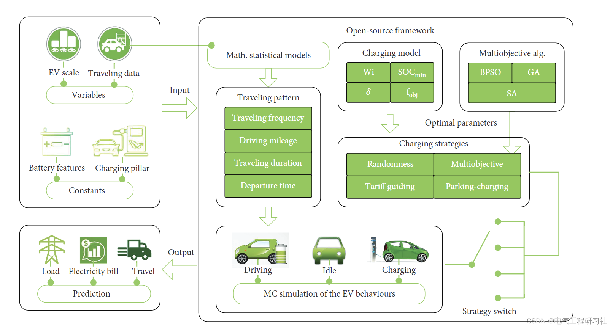
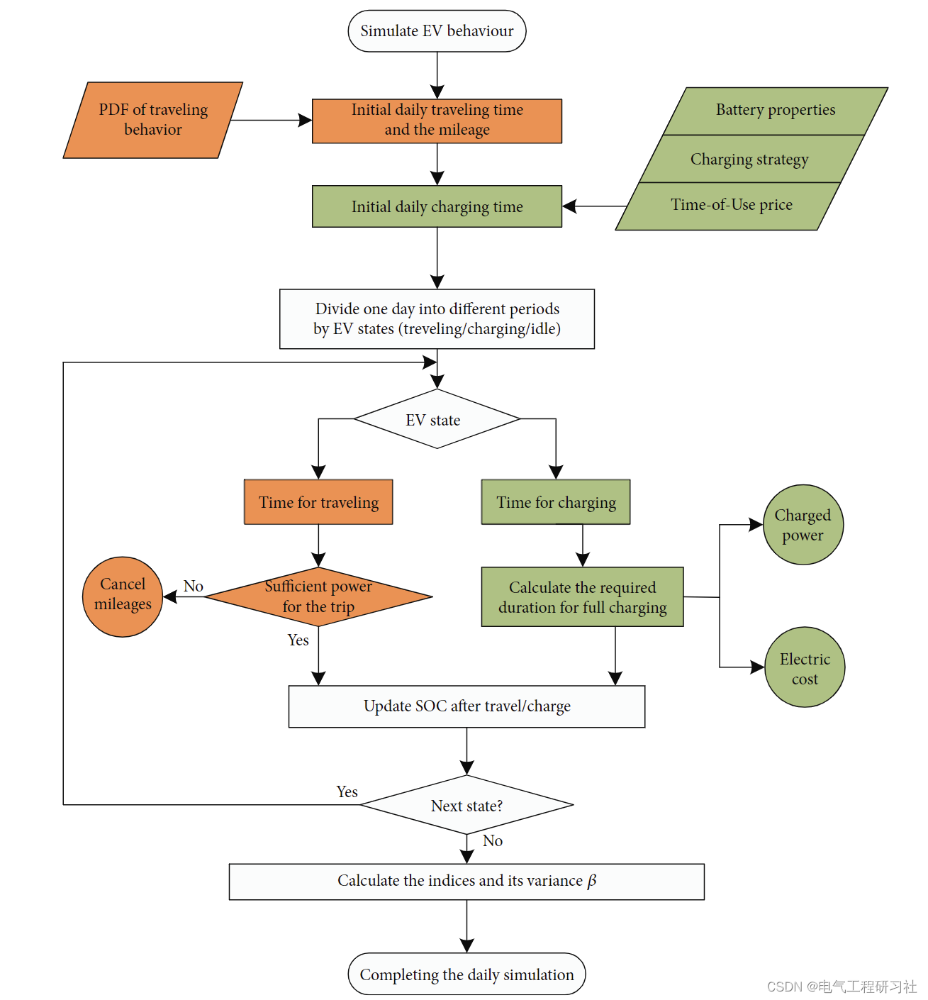
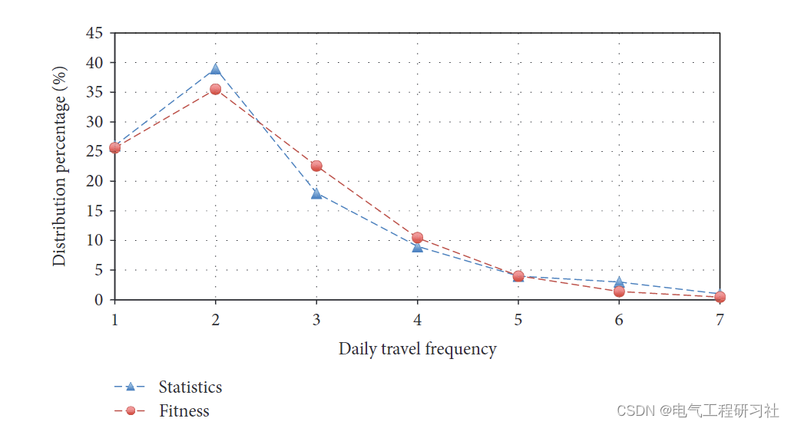
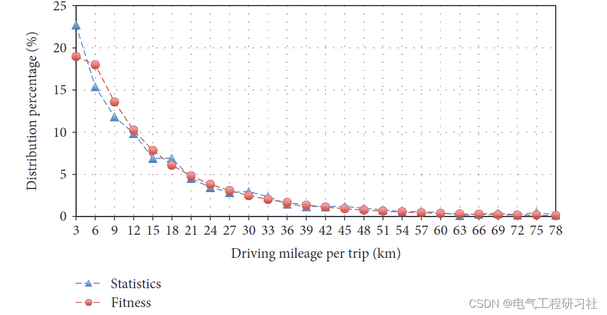
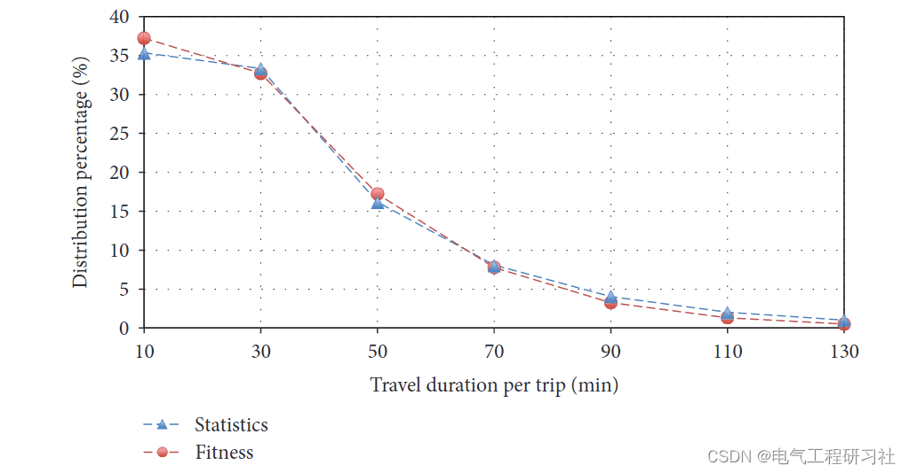
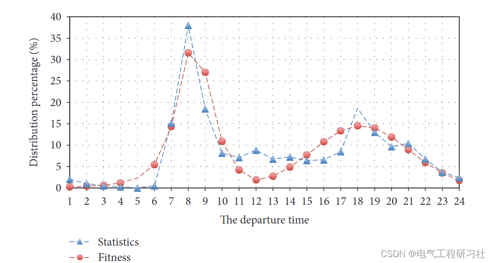
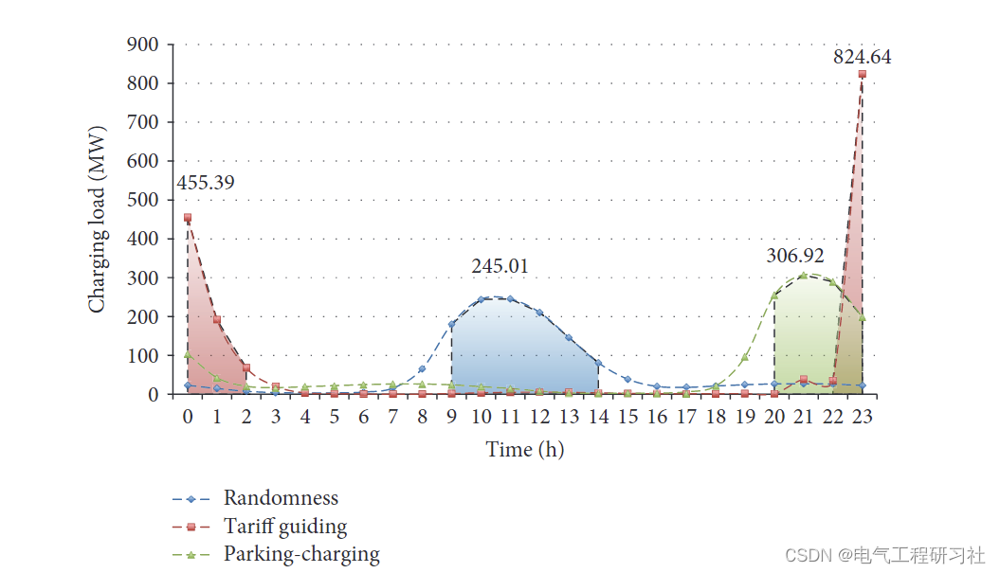
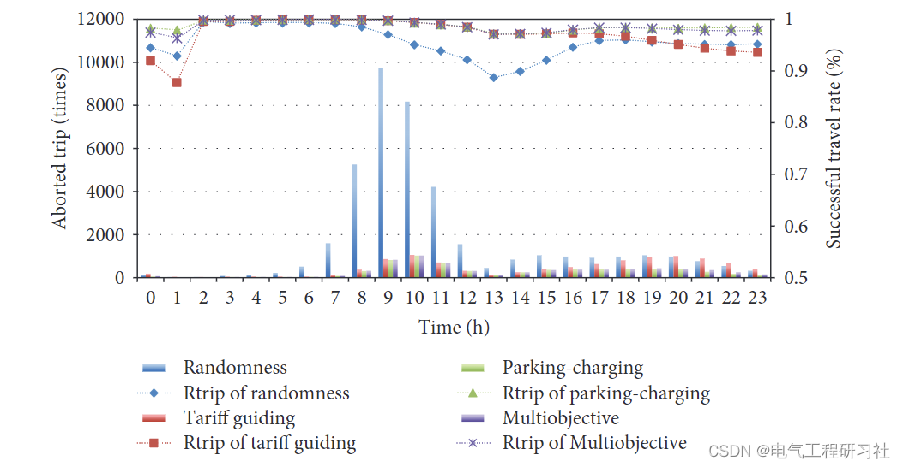

# Analysis of Large-Scale Electric Vehicle Charging Behavior Based on Monte Carlo Simulation (Matlab Code Implementation)

1. Overview of the Charging Plan
The charging plan is typically determined by two factors: availability of charging (charging status) and charging strategy [10]. Since the energy consumption of daily electric vehicle operations is lower than the rated capacity of the battery, it is unnecessary to charge an electric vehicle every day. Only when the battery's state of charge (SOC) falls below a threshold can the EV start charging. The charging strategy plays a significant role in assessing the impact of electric vehicles on the power system, which can be categorized into (1) simple charging (plug-and-play), where no planning is involved and charging occurs whenever the charging infrastructure is available or at the end of a day's journey; (2) cost-driven charging, where charging is cheaper during off-peak periods; (3) intelligent charging, where additional battery energy can serve as an energy source during peak hours to facilitate grid stability.
This paper discusses the impact of electric vehicle charging behavior on grid load. By analyzing and fitting the historical data of residents' travel patterns for electric vehicles, a travel pattern model was established to predict their probability distribution. A comprehensive nonlinear stochastic programming model with the highest index was developed to analyze charging schemes, and a heuristic search algorithm was employed to optimize parameter configurations. Comparing evaluation criteria, multi-objective strategies were found to be more suitable for charging, specifically electricity prices. Additionally, considering the characteristics of normal batteries and charging stations, user behavior, and the scale of electric vehicles, a Monte Carlo simulation process was designed to simulate long-term large-scale electric vehicle travel behavior. The obtained simulation results can provide predictions for future energy demand growth trends associated with the regulation of electric vehicles.
2. Mathematical models with the air quality caused by global fuel-powered vehicles. The gradual deterioration of environmental and energy crises, Renewable energy vehicles, specifically electric vehicles (EV), are being heavily promoted by governments around the world. And many policies related to its development have been introduced. With the continuous improvement of technology and infrastructure construction, Electric vehicles will become the main mode of transportation in the future. However, The continuous growth of electric vehicle energy demand has put a heavy burden on the power grid. Grid regulation has serious uncertainties [1]. Generally speaking, A single EV connected to the grid is roughly equivalent to the load requirements of a small family. The state of California, which is the most popular electric vehicle market in the United States, currently faces issues with grid upgrades. The impact of electric vehicles on the distribution network has been discussed in [3–5]. The factors involved can be summarized as driving mode. Battery characteristics. Charging plans and EV penetration rates.
Electric Vehicle Load Estimation Based on Monte Carlo Simulation After determining the optimal objective and key influencing factors. The issue of electric vehicle charging can be configured as a nonlinear programming model. Under the constraints of electric vehicle battery characteristics and user travel modes. The objective function can be established according to the different needs of the supplier and electric vehicle users. Thus, the optimal charging scheme is obtained. Uncertain variables in the model. That is W i. Quantitatively through MC simulation tool. Simulate daily EV driving. Charging and relaxation states. Furthermore, A statistical model for travel habits and electric vehicle charging behaviors has been established. Improved the credibility of MC simulation.
Detailed mathematical models and explanations are provided in Part 4.
Flowchart:
Editor
3. Running Results Editing
Editor
Editor
Editor
Editor
4. Matlab code and article detailed reading. This article only displays a part of the code, all codes and articles can be found in:
function main()\n    clc; close all; clear;\n    \n    global all_scores\n    \n    %% Loading code\n    thesis = pwd;\n    path(strcat(thesis, '/opt;'), path);\n    path(strcat(thesis, '/opt/GA;'), path);\n    path(strcat(thesis, '/opt/PSO;'), path);\n    path(strcat(thesis, '/opt/SA;'), path);\n    path(strcat(thesis, '/opt/scores;'), path);\n    \n    %% Select optimization algorithm: 0--directly run; 1--GA; 2--PSO; 3--SA\n    alg = 3;\n    nVars = 5;      %5;\n    nPopSize = 1;       %debug by fei\n    nIters = 3000;\n    all_scores = inf*ones(nPopSize, nIters);\n    \n    %% Solve for the optimal parameter values.\n    defaultWCoeff = ones(1, 4) * 0.25;\n    defaultMinSOC = 0.2;\n    \n    %% MC simulation run\n    if alg == 0\n        FuncFitness( [defaultWCoeff, defaultMinSOC] );\n        bestWCoeff = defaultWCoeff;\n        bestMinSOC = defaultMinSOC;\n        \n    else\n        if alg == 1\n            AlgFunc = @GA_MC;\n        elseif alg == 2\n            AlgFunc = @PSO_MC;\n        elseif alg == 3\n            AlgFunc = @SA_MC;\n        end\n        \n        [bestWCoeff, bestMinSOC] = AlgFunc(@PopFunction, @FuncFitness, ...\n                                        nVars, nPopSize, nIters);\n    end\n    \n    % Save optimization results\n    save(sprintf('OPT_result_Alg(%d)_PopSize(%d)_Gens(%d).mat', ...\n        alg, nPopSize, nIters), ...\n        'bestWCoeff', 'bestMinSOC', 'all_scores', '-v7.3');\nend\n\n\nfunction [xPop] = PopFunction(GenomeLength,~,options)\n    nPop = options.PopulationSize;\n    RD = rand;\n    xPop = (rand(nPop, GenomeLength) > RD);\nend\n\n\nfunction [FitVal] = FuncFitness(pop)\n    % Initial parameters\n    nTerms = 1;\n    nDaysPT = 30;   %debug by fei\n    nEVs = 100;\n    chargingStrategy = 4;\n    isOutput = false;\n    \n    % Convert binary sequence into a numerical value that conforms to certain constraints\n    [wCoeff, minSOC] = Bin2VarByConstraint(pop);\n    \n    % MC simulation\n    [all_indices, mday_indices] = EVPowerLoad(nTerms, nDaysPT, nEVs, ...\n                            chargingStrategy, wCoeff, minSOC, isOutput);\n    \n    % Fitness: the lower its value, the better the performance\n    FitVal = 1 - mday_indices;\n    %fprintf('----Average comprehensive index: Y=%f, fitting degree=%f----\n', mean(all_indices), FitVal);\nend\n\n\n\n  
5 Conclusion This study investigates the large-scale charging behavior of electric vehicles and discusses intelligent charging strategies. First, a travel pattern probability distribution model based on actual traffic data is established to enhance the reliability of predictions. Considering the benefits for electric vehicle users and power suppliers, evaluation indicators are selected, including load peaks, charging costs, and driving speed. With the constraints imposed by the characteristics of electric vehicle batteries and user travel statistics, a multi-objective charging strategy is developed, determining parameters through a new constrained optimization method with feature selection. Monte Carlo simulations are conducted to simulate electric vehicle activities, and an open-source system with a universal framework is released to promote research on the impact of large-scale electric vehicles on local grid load.
In summary, the adoption of probability distribution statistics, Monte Carlo simulations, evaluation indicators, and electric vehicle charging models can provide alternative solutions for discussing the development of large-scale electric vehicles and grid resource allocation. Further research will focus on modeling different types of electric vehicles (i.e., public transportation) during holidays using MC, as well as the connection patterns of electric vehicles in real-world power grids. Additionally, more emphasis should be placed on statistical analysis of electric vehicle access to distributed grid nodes, which can provide insights into how to implement the proposed methods in local distribution networks.
6 Final Thoughts

## Images

<!-- PAYMENT_BLOCK -->

## Get this dataset

- Payment link (Stripe): [Buy now](https://buy.stripe.com/3cs8yP7sY87d0vu9AB)
- Payment QR code: 

<!-- /PAYMENT_BLOCK -->
